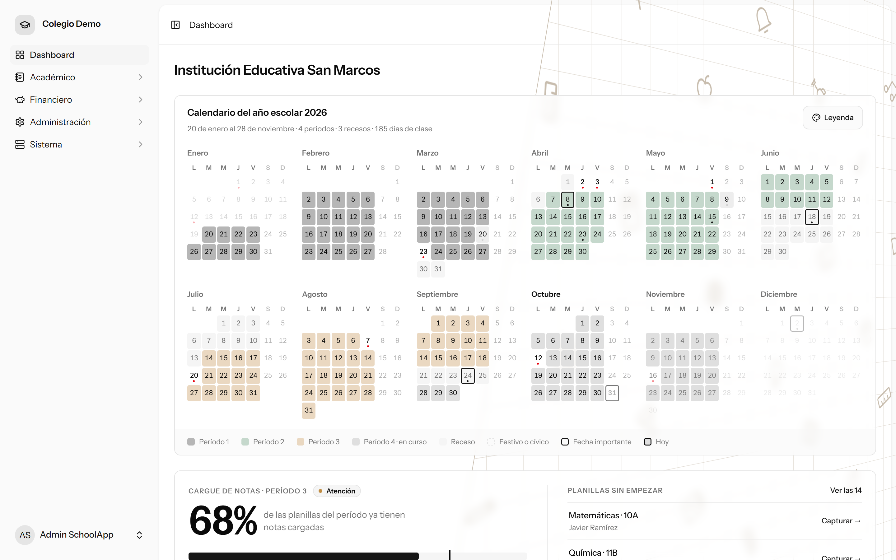
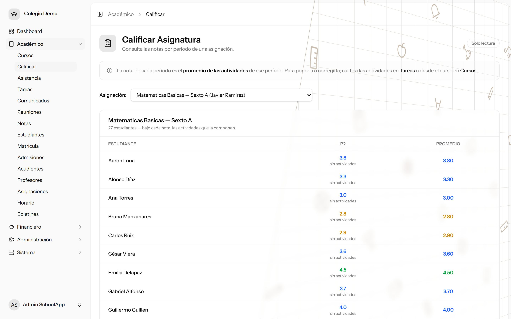
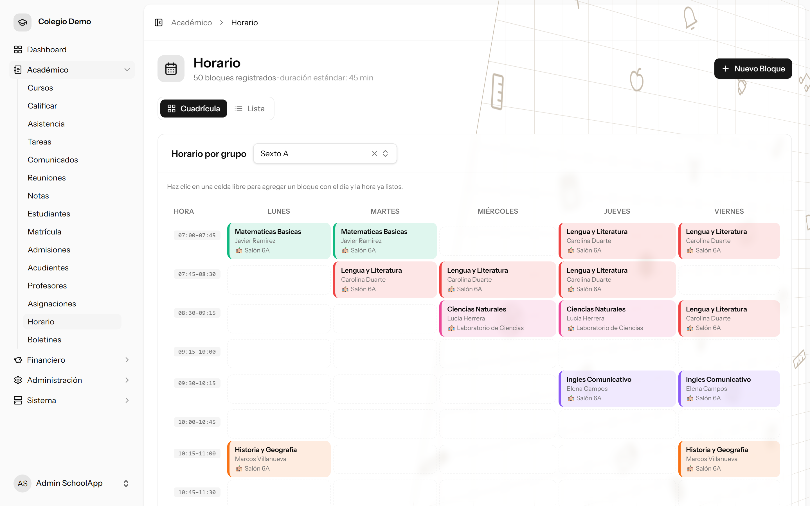
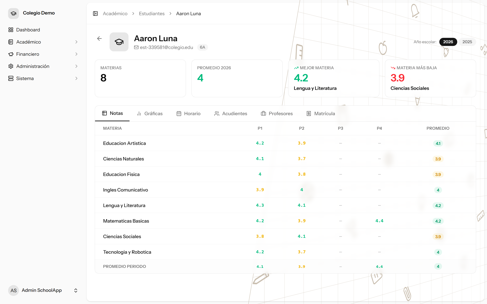
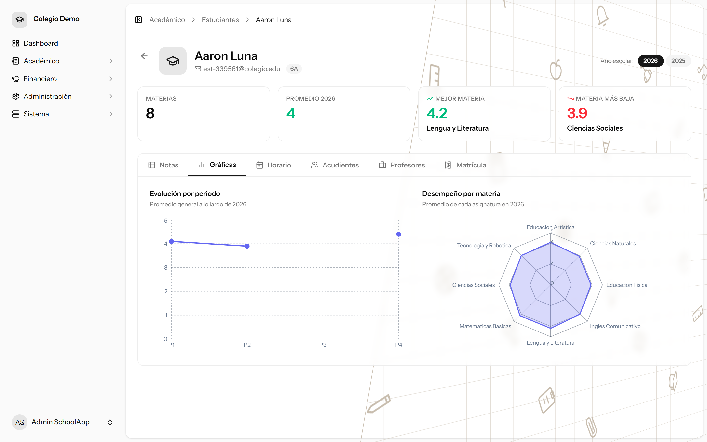

# 🏫 SchoolApp — Gestión escolar multi-colegio

> Plataforma web para que un colegio lleve notas, horarios, estudiantes, acudientes y cobros en un
> solo sistema, con **permisos por persona** y **datos aislados por colegio**.

`Laravel 13` · `PHP 8.4` · `Inertia 2` · `React 19` · `TypeScript` · `Tailwind 4` · `Recharts` · `Pest`

> **Problem:** Schools run grades, schedules, payments and family communication in separate tools, and a multi-school product cannot leak data between schools.  
> **Solution:** A multi-tenant platform where each school manages academics, finances and family communication, with per-person permissions.  
> **Stack:** Laravel 13, Inertia 2, React 19, TypeScript, Tailwind 4, Recharts, Pest.  
> **Live demo:** None (private product; a walkthrough is available on request).  
> **My role:** Main developer, with one occasional collaborator: data model and multi-tenant isolation, roles and permissions, parent portal and payments, schedule, report cards, and an AI-assisted workflow.

*Capturas tomadas de una base de demostración con un colegio y nombres ficticios.*

---

## El problema
Un colegio suele repartir su operación en herramientas sueltas: notas en Excel, horarios en Word,
cobros en otro lado y comunicación con las familias por WhatsApp. Nadie ve el cuadro completo, los
datos se duplican y cada cambio de horario o de nota obliga a avisar a mano.

Además, un producto pensado para varios colegios tiene un riesgo que no se puede permitir: que los
datos de un colegio aparezcan en otro.

## La solución
Una plataforma donde cada rol ve solo lo que le corresponde:

- **📚 Notas.** La nota de cada período es el promedio de las actividades calificadas.
- **🗓️ Horario en cuadrícula** con alta rápida de bloques y control de la intensidad horaria del pensum.
- **🎓 Ficha histórica del estudiante** por año escolar, con evolución por período y radar por materia.
- **👪 Portal del acudiente:** automatrícula pública, varios estudiantes por familia, pago de matrícula
  en línea y notificaciones.
- **🧑‍🏫 Vista del docente** con su día y sus asignaciones.
- **📥 Carga masiva** de estudiantes por CSV con revisión antes de confirmar; exportación a Excel.
- **🏢 Multi-sede** y toggle **público/privado** que oculta lo financiero en colegios públicos.

## Capturas

| | |
|---|---|
|  |  |
| *Calificar una asignación.* | *Horario por grupo.* |
|  |  |
| *Ficha del estudiante.* | *Evolución y radar de desempeño.* |

## Decisiones técnicas destacadas
- **Aislamiento por tenant en el modelo, no en cada consulta.** Una sola base de datos; un trait
  (`BelongsToTenant`) aplica un *global scope* y sella `tenant_id` al crear, y un middleware fija el
  colegio activo desde el usuario autenticado. Olvidarse de filtrar no es posible por construcción.
  Las claves que podían chocar entre colegios (códigos de materia, correos) son únicas **por tenant**.
- **Inertia en lugar de API REST.** Los controladores devuelven páginas React; no hay una API aparte
  que versionar. Las rutas se tipan en el frontend con Laravel Wayfinder.
- **RBAC granular `modulo.accion`.** Los permisos se comprueban con un middleware en las rutas y la
  interfaz oculta lo que el usuario no puede usar. Cada colegio arma sus propios roles.
- **Importación con staging.** La carga masiva primero guarda en una tabla intermedia, muestra qué se
  va a crear u omitir y solo entonces confirma.
- **Decisiones escritas.** 40 ADR (multitenancy, RBAC, PDF, importación, pagos, tratamiento de datos
  personales…) en un vault de Obsidian versionado junto al código.
- **Trabajo con IA con reglas.** Varias herramientas de IA trabajaron en paralelo bajo una metodología
  explícita: una rama por tarea, tablero de trabajo en curso, encabezado de 5 líneas por archivo y
  quality gate (`lint + format + types + test`) antes de entregar.

## Números del repositorio
48 modelos · 40 migraciones · 61 clases de prueba · 43 decisiones de arquitectura documentadas (ADR). Desarrollado de marzo a agosto de 2026.

## Resultado
Producto funcional de punta a punta en un colegio de demostración: flujo académico, portal del
acudiente, cobro de matrícula (driver simulado y Wompi en sandbox) y administración de roles. **No llegó a
producción**: el proyecto está en pausa desde agosto de 2026. Quedaron pendientes la paginación y los
filtros de los listados grandes, la nómina y el buscador global.

## Mi rol
Desarrollador principal, con un colaborador puntual. Hice el modelo de datos y el **aislamiento
multi-colegio**, el sistema de **roles y permisos** (incluido el superadministrador con 2FA), el
**portal del acudiente** y el cobro de matrícula con **webhook de pagos firmado e idempotente**, el
horario y el pensum, los boletines en PDF, la importación por lotes, las notificaciones y el sitio
público, además de la metodología de trabajo con IA. El módulo **Cursos** (notas, tareas y asistencia
por clase) y el calendario del dashboard los construyó mi colaborador.

---

> 🔒 **Código fuente privado.** Este repositorio es solo el *case study*. Puedo mostrar el código y
> la app en funcionamiento en una entrevista técnica.

**Contacto:** [GitHub](https://github.com/KevinHGitCode) · kevinhafiddiazgarcia@gmail.com
